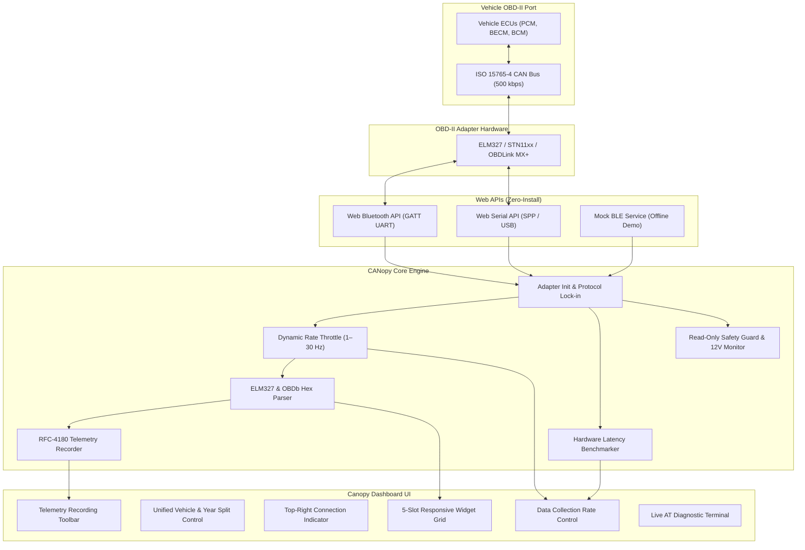

# Canopy 

> **Modern, Web-Native OBD-II & CAN Bus Telemetry Dashboard**  
> Connect wirelessly via Bluetooth Low Energy (BLE), Bluetooth Classic (SPP), or USB diagnostic cables directly in your browser. Powered by the open-source [OBDb Community Database](https://github.com/OBDb).
>
> 🌐 **Live Web Application**: [https://narenkarikkathil-prog.github.io/CANopy/](https://narenkarikkathil-prog.github.io/CANopy/)

---

## Table of Contents

- [Overview](#overview)
- [System Architecture](#system-architecture)
- [Key Features](#key-features)
  - [1. Multi-Standard Hardware Connectivity](#1-multi-standard-hardware-connectivity)
  - [2. Configurable Data Collection Rate & Scientific Auto-Tuning](#2-configurable-data-collection-rate--scientific-auto-tuning)
  - [3. Live Telemetry Recording & RFC-4180 CSV Export](#3-live-telemetry-recording--rfc-4180-csv-export)
  - [4. Responsive 5-Slot Telemetry Dashboard](#4-responsive-5-slot-telemetry-dashboard)
  - [5. Vehicle Profiles & OBDb Signalsets](#5-vehicle-profiles--obdb-signalsets)
  - [6. Custom PID Builder & Command Library](#6-custom-pid-builder--command-library)
  - [7. Bulk CSV Profile Import & Export](#7-bulk-csv-profile-import--export)
  - [8. Live AT Diagnostic Console](#8-live-at-diagnostic-console)
  - [9. Diagnostic Safety Architecture & 12V Battery Guard](#9-diagnostic-safety-architecture--12v-battery-guard)
- [Hardware & Browser Compatibility](#hardware--browser-compatibility)
  - [Platform Compatibility Matrix](#platform-compatibility-matrix)
  - [Recommended Hardware Adapters](#recommended-hardware-adapters)
- [Data Collection Rate & Polling Physics](#data-collection-rate--polling-physics)
  - [Scientific Hardware Default Rates](#scientific-hardware-default-rates)
  - [Adapter Latency Benchmarking](#adapter-latency-benchmarking)
- [Telemetry Recording & CSV Specification](#telemetry-recording--csv-specification)
  - [CSV Column Structure](#csv-column-structure)
  - [Example Export](#example-export)
- [Formula Syntax & Custom PID Guide](#formula-syntax--custom-pid-guide)
- [Getting Started & Local Development](#getting-started--local-development)
  - [Prerequisites](#prerequisites)
  - [Installation & Build](#installation--build)
  - [GitHub Pages Deployment](#github-pages-deployment)
- [Project Directory Structure](#project-directory-structure)
- [License & Attribution](#license--attribution)

---

## Overview

**Canopy** is an open-source, browser-native automotive telemetry, logging, and diagnostics platform. It connects to your vehicle's 16-pin OBD-II port through standard ELM327- and STN-compatible adapters using the modern **Web Bluetooth API** and **Web Serial API**—requiring zero native software installation, drivers, or app-store downloads.

Whether you drive an electric vehicle (such as the Ford Mustang Mach-E), a hybrid (Ford Fusion Hybrid, Toyota Highlander Hybrid), or any standard internal-combustion engine (ICE) vehicle, Canopy provides fluid visual gauges, rolling historical graphs, high-frequency telemetry logging, custom PID creation, and a real-time AT terminal.

---

## System Architecture



---

## Key Features

### 1. Multi-Standard Hardware Connectivity
- **Bluetooth Low Energy (BLE 4.0/5.0)**: Wireless connection via the Web Bluetooth API. Supported out-of-the-box on iPhone/iPad using Web BLE browsers like [Bluefy](https://apps.apple.com/app/bluefy-web-ble-browser/id1492822055), and natively on desktop Google Chrome and Microsoft Edge.
- **Bluetooth Classic (BT / SPP)**: High-speed serial connection (up to 115,200 baud) for premium adapters like the OBDLink MX+, OBDLink LX, and vLinker on Android, Windows, macOS, and Linux.
- **USB Serial Cables**: Direct wired diagnostic cables (OBDLink EX, OBDLink SX, FTDI FT232R, CH340, Prolific PL2303, CP2102) with sub-millisecond physical latency.
- **Offline Adapter Simulation**: Built-in dynamic ELM327 BLE simulator that generates plausible live CAN responses for any vehicle profile without requiring physical hardware.

### 2. Configurable Data Collection Rate & Scientific Auto-Tuning
- **Adjustable Frequency (1 to 30 requests/second)**: Configure how frequently CANopy queries the vehicle bus for live sensor readings.
- **Real-Time Throughput Monitor**: Displays the configured target rate and live measured throughput (e.g. `10 req/s (~100 ms) • Live: 9.8 req/s`).
- **Speed Presets**: One-click pills for **2 Hz** (Eco / Battery Saver), **5 Hz** (Conservative), **10 Hz** (Default recommended), **15 Hz** (Fast), and **20 Hz** (STN / Ultra).
- **Fine-Tuning Stepper & Range Slider**: Dial in exact querying rates from 1 to 30 Hz.
- **Scientific Hardware Profile Auto-Detection**: Automatically identifies adapter hardware tiers (STN 32-bit vs. standard ELM327 vs. legacy protocols) and chooses the safe optimal default.
- **Hardware Latency Benchmarking**: An active 1-click speed test that sends 3 probe queries, calculates average round-trip latency ($T_{\text{avg}}$ ms), and determines maximum physical throughput.
- **High-Rate Safety Warning**: Displays an alert when selecting rates $>12\text{ req/s}$ to inform users of potential buffer overflows on low-cost clone adapters.

### 3. Live Telemetry Recording & RFC-4180 CSV Export
- **One-Click Session Logging**: Clean recording toolbar mounted above the dashboard with Record, Stop, and Discard controls.
- **Persistent Header Indicator**: Displays live recording status and elapsed duration (`REC 00:04:12`) across all views.
- **High-Fidelity CSV Export**: Exports timestamped data meeting RFC-4180 specifications:
  - ISO 8601 UTC timestamps (`2026-10-29T20:15:30.123Z`).
  - Session elapsed time in floating-point seconds (`14.524`).
  - High-resolution epoch timestamps (ms).
  - Triggered command names, Mode/PIDs, and engineering units.
  - Snapshot columns across all active sensor channels.
- **Client-Side File Generation**: Downloads directly through the browser without sending data to any external server.

### 4. Responsive 5-Slot Telemetry Dashboard
- **Modular Widget Types**:
  - **Radial Gauges**: Circular indicators with min/max bounds, smooth transitions, and 6 custom accent themes (Gold, Bronze, Cobalt, Emerald, Crimson, Amethyst).
  - **Time-Series Charts**: Rolling trend charts with configurable time windows (30s, 60s, 120s, 300s) and auto/manual scaling.
  - **Stat Metric Cards**: High-visibility numerical displays with min, max, and average tracking.
  - **Signal Tables**: Compact tabular views for monitoring multiple telemetry streams simultaneously.
- **Dynamic Unit Conversion**: Converts on-the-fly between metric and imperial units (°C ↔ °F, km/h ↔ mph, kPa ↔ PSI ↔ bar, L/100km ↔ MPG).
- **Signal Source Search & Filter**: Interactive picker modal featuring multi-token search (PID hex, signal name, units), category filter pills with count badges, and selected item previews.

### 5. Vehicle Profiles & OBDb Signalsets
- Bundled profiles directly compiled from the open-source **OBDb Community Database**:
  - **Ford Mustang Mach-E**: High-voltage battery pack voltage/current, state of charge (SOC), cell temperatures, motor speeds, and thermal telemetry.
  - **Ford Fusion Hybrid & Energi**: Hybrid battery state of charge, module voltages, generator speeds, and drive modes.
  - **Toyota Highlander & Grand Highlander (Hybrid & Gas)**: Hybrid Synergy Drive (HSD) metrics, inverter temps, and traction battery data.
  - **SAE J1979 Standard OBD-II**: Universal Mode 01 parameters (RPM, vehicle speed, coolant temp, intake air temp, throttle position, etc.).
- **Unified Split Control**: Elegant split pill in the top header combining active vehicle profile and model year selection with smooth dropdown transitions.

### 6. Custom PID Builder & Command Library
- Browse hundreds of Mode 01, Mode 21, and Mode 22 (UDS ReadDataByIdentifier) signals.
- **Custom Command Drawer**: Define custom PIDs with custom CAN request headers (e.g. `7E0`, `6F5`), custom formulas (`((A*256)+B)/4`), signed two's-complement handling (`signed(...)`), and custom units.
- Delete custom commands directly from the library.

### 7. Bulk CSV Profile Import & Export
- Bulk import custom vehicle signal profiles using standard CSV files.
- Includes strict schema validation, formula syntax testing, and an instant template download.
- Export vehicle command catalogs for backup or sharing with the OBDb community.

### 8. Live AT Diagnostic Console
- Real-time logging of all raw `TX` (transmitted) and `RX` (received) ELM327 frames.
- Direction-based filtering (`TX`, `RX`, `INFO`, `ERROR`) and auto-scroll controls.
- Protocol step-by-step initialization sequence inspection (`AT Z` → `AT E0` → `AT SP 6` → `AT H1`).
- Manual command prompt for testing direct query responses.

### 9. Diagnostic Safety Architecture & 12V Battery Guard
- **Strict Read-Only Allowlist**: Commands that write to flash memory, reset ECUs, clear DTCs, or actuate relays (e.g. UDS modes `0x2E`, `0x2F`, `0x31`, `0x10`, `0x14`) are strictly blocked at the transport layer.
- **12V Auxiliary Battery Guard**: Continuously checks 12V system voltage (`AT RV`) and pauses polling if voltage drops below 10.5V to protect auxiliary batteries from parasitic drain.

---

## Hardware & Browser Compatibility

### Platform Compatibility Matrix

| Operating System | Recommended Browser | Supported Connection Modes |
|---|---|---|
| **Apple iOS (iPhone & iPad)** | [Bluefy Web BLE Browser](https://apps.apple.com/app/bluefy-web-ble-browser/id1492822055) (Free on App Store) | **Bluetooth Low Energy (BLE)** |
| **Android** | Google Chrome, Microsoft Edge, Opera | **BLE**, **Bluetooth Classic (BT / SPP)** |
| **Windows 10 / 11** | Google Chrome, Microsoft Edge | **BLE**, **Bluetooth Classic (BT / SPP)**, **USB Serial** |
| **Linux** | Google Chrome, Chromium, Microsoft Edge | **BLE**, **Bluetooth Classic (BT / SPP)**, **USB Serial** |

### Recommended Hardware Adapters

1. **Bluetooth Low Energy (BLE)**:
   - **OBDLink CX**: Best-in-class BLE adapter, low power, auto-sleep, fully compatible with iOS Bluefy and Android Chrome.
   - **Veepeak OBDCheck BLE / BLE+**: Reliable, affordable, universally supported.
   - **Vgate iCar Pro BLE 4.0**: Compact and power-efficient.
   - **Carista OBD**: Fully compatible with standard ELM327 BLE profile.
   - **VLinker MC+**: BLE adapter, low power, fully compatible
2. **Bluetooth Classic (SPP)**:
   - **OBDLink MX+ / LX**: Ultra-high data rates, large internal memory buffer.
   - **vLinker FD+ / MC+**: STN-compatible processor, fast baud rates.
3. **USB Serial**:
   - **OBDLink EX / SX**: Direct wired connection, ideal for workshop and stationary tuning.
   - **FTDI FT232R / CH340**: Universal USB-to-OBD diagnostic cables.

---

## Data Collection Rate & Polling Physics

Requesting diagnostic data from a vehicle requires communication across three separate layers:
1. **Wireless / Serial Link**: Latency of Web Bluetooth GATT or Web Serial transmission ($5\text{–}20\text{ ms}$).
2. **Adapter Microcontroller**: Processing the ASCII AT/PID command and buffering the frame ($1\text{–}20\text{ ms}$).
3. **Vehicle CAN Bus**: Arbitration, ECU internal priority, and multi-frame response transmission ($15\text{–}50\text{ ms}$).

### Scientific Hardware Default Rates

Canopy inspects the adapter during the connection handshake to determine a safe, optimal default querying frequency:

| Hardware / Protocol Detected | Default Rate | Engineering Rationale |
|---|---|---|
| **STN Chipsets (STN11xx, STN21xx, OBDLink)** | **20 req/s** (50 ms) | High-speed 32-bit RISC core with multi-kilobyte hardware FIFOs and fast CAN filters. |
| **ELM327 with Adaptive Timing 2 (AT2)** | **12 req/s** (83 ms) | Microcontroller dynamically adapts timeouts based on ECU response speed on 500 kbps CAN. |
| **Standard ELM327 BLE on CAN** | **10 req/s** (100 ms) | Prevents BLE GATT notification queue overflow on low-cost PIC18F clones. |
| **Legacy Non-CAN Protocols (J1850, ISO 9141, KWP)** | **4 req/s** (250 ms) | Physical bus speed is limited to 10.4–41.6 kbps; higher rates cause CAN bus collisions. |
| **Offline Simulator** | **10 req/s** (100 ms) | Smooth visual animations with zero CPU overhead. |

### Adapter Latency Benchmarking

On the **Connection** page, clicking **Benchmark Adapter Speed** triggers a live latency probe:
- Transmits 3 diagnostic probes (`AT RV` / `0100`) and records physical round-trip response time ($T_{\text{RTT}}$).
- Calculates average latency: $T_{\text{avg}} = \frac{1}{3} \sum T_i$.
- Calculates maximum throughput: $R_{\text{max}} = \lfloor 1000 / T_{\text{avg}} \rfloor\text{ req/s}$.
- Configures a safe recommended target rate with a $25\%$ safety margin: $R_{\text{safe}} = \lfloor R_{\text{max}} \times 0.75 \rfloor$.

---

## Telemetry Recording & CSV Specification

Canopy exports telemetry sessions in standard **RFC-4180 CSV** format.

### CSV Column Structure

| Column | Header | Type | Description |
|---|---|---|---|
| 1 | `Timestamp (ISO)` | String | ISO 8601 UTC timestamp (`YYYY-MM-DDTHH:mm:ss.sssZ`) |
| 2 | `Elapsed Time (s)` | Number | Elapsed session time in seconds with millisecond resolution (`12.345`) |
| 3 | `Timestamp (ms)` | Integer | Unix epoch timestamp in milliseconds |
| 4 | `Triggered Signal` | String | Name of the parameter that triggered the telemetry sample |
| 5..N | `[Signal Name] ([PID]) [[Units]]` | Number | One column per unique logged vehicle sensor with unit annotation |

### Example Export

```csv
Timestamp (ISO),Elapsed Time (s),Timestamp (ms),Triggered Signal,Engine RPM (010C) [RPM],Vehicle Speed (010D) [km/h],Coolant Temp (0105) [°C]
"2026-10-29T20:25:01.100Z",0.000,1793305501100,"Engine RPM",2140.5,65,88
"2026-10-29T20:25:01.215Z",0.115,1793305501215,"Vehicle Speed",2142.0,65,88
"2026-10-29T20:25:01.320Z",0.220,1793305501320,"Coolant Temp",2145.0,66,89
```

---

## Formula Syntax & Custom PID Guide

When defining custom vehicle parameters or creating CSV profiles, formulas map hexadecimal data bytes returned by the ECU to real-world engineering values:

- `A` = 1st response data byte ($0\text{–}255$)
- `B` = 2nd response data byte ($0\text{–}255$)
- `C` = 3rd response data byte ($0\text{–}255$)
- `D` = 4th response data byte ($0\text{–}255$)

### Common Formula Examples

| Parameter | Mode / PID | Formula | Resulting Unit |
|---|---|---|---|
| **Engine RPM** | `010C` | `((A*256)+B)/4` | RPM |
| **Vehicle Speed** | `010D` | `A` | km/h |
| **Coolant Temperature** | `0105` | `A-40` | °C |
| **Control Module Voltage** | `0142` | `((A*256)+B)/1000` | V |
| **HV Battery Current (Signed)** | `224803` | `(signed(A*256+B))*0.05` | A |
| **Battery State of Charge** | `224801` | `((A*256)+B)*0.1` | % |

---

## Getting Started & Local Development

### Prerequisites
- [Node.js](https://nodejs.org/) (version 18.0 or higher)
- npm or yarn

### Installation & Build

```bash
# 1. Clone repository
git clone https://github.com/narenkarikkathil-prog/CANopy.git
cd CANopy

# 2. Install dependencies
npm install

# 3. Start local development server
npm run dev

# 4. Compile and verify TypeScript production build
npm run build
npm run preview
```

### GitHub Pages Deployment

Canopy is configured for zero-configuration automated deployment to **GitHub Pages** via GitHub Actions:
- The workflow is located at [`.github/workflows/deploy.yml`](.github/workflows/deploy.yml).
- Whenever changes are pushed to `main`, GitHub Actions automatically runs `npm run build` and publishes the static `/dist` directory to GitHub Pages.

---

## Project Directory Structure

```
CANopy/
├── .github/
│   └── workflows/
│       └── deploy.yml        # GitHub Actions automated Pages deployment
├── src/
│   ├── components/
│   │   ├── ble/              # Connection manager, rate controls, AT console
│   │   ├── commands/         # Command catalog, custom PID builder, CSV uploader
│   │   ├── dashboard/        # Gauges, line graphs, stat cards, recording bar
│   │   ├── help/             # Connection guide, hardware matrix, CSV docs
│   │   └── layout/           # App navigation sidebar and top header
│   ├── context/
│   │   ├── BLEContext.tsx    # Connection state, polling loop, data rate, logging
│   │   ├── VehicleContext.tsx# Active vehicle profile, custom signals, year filter
│   │   └── WidgetContext.tsx # 5-slot dashboard widget layout and configuration
│   ├── data/
│   │   ├── defaultVehicles.ts# Fallback vehicle profiles and initialization PIDs
│   │   └── obdbBundle.ts     # Pre-bundled OBDb vehicle datasets
│   ├── services/
│   │   ├── adapterInit.ts    # Fast sync, reset, protocol negotiation, and caps probe
│   │   ├── bleService.ts     # Web Bluetooth API driver (GATT UART)
│   │   ├── serialService.ts  # Web Serial API driver (Bluetooth Classic & USB)
│   │   ├── mockBleService.ts # Dynamic offline ELM327 BLE simulator
│   │   ├── obdParser.ts      # ELM327 hex decoder & formula engine
│   │   ├── obdbParser.ts     # OBDb dataset parser & safety allowlist
│   │   ├── telemetryRecorder.ts # Telemetry session buffer & RFC-4180 CSV export
│   │   ├── widgetResolver.ts # Signal resolution, precision, and unit conversion
│   │   └── csvEngine.ts      # CSV parser and template generator
│   ├── types/                # TypeScript interfaces (telemetry, ble, widgets)
│   ├── App.tsx               # Root application component and routing
│   └── index.css             # Theme variables, responsive styles, animations
├── package.json
└── vite.config.ts            # Vite configuration with relative base path
```

---

## License & Attribution

- **Source Code**: Released under the [MIT License](LICENSE).
- **Vehicle Signal Database**: Powered by the [OBDb Community Database](https://github.com/OBDb), licensed under the **Creative Commons Attribution-ShareAlike 4.0 International (CC BY-SA 4.0)** license.
- **Third-Party Icons**: [Tabler Icons](https://tabler-icons.io/) (MIT License).
